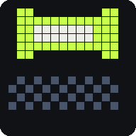
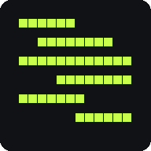

<p align="center">
  
</p>

<p align="center">
  <a href="https://hong.build"><b>hong.build</b></a> &nbsp;·&nbsp;
  <a href="https://hong.build/hack/">Hackathon Crash Course</a> &nbsp;·&nbsp;
  <a href="https://hong.build/agents">For agents</a>
</p>

# hong.build

Personal site for Hong Bing Sim — [hong.build](https://hong.build).

The home page is one continuous scroll journey: a walk through eleven rooms of a 3D cloud of 7,000 fragments, one room per chapter. Each room's dust gathers into that chapter's silhouette as you arrive. Opening a chapter lifts its page out of the cloud as a window standing in the room. The rest of the site is ordinary pages — work, about, process, run log and contact — plus the [Hackathon Crash Course](hack-src/README.md) at `/hack`.

The site is also written for agents: every page is available as markdown (`Accept: text/markdown`, or append `.md`), with `llms.txt`, `profile.json` and an `/agents` page.

## The eleven rooms

The journey is eleven chapters. Scroll and the camera walks from room to room; each room's dust gathers into its own shape. The gaps shrink as you go, because the years did.

| | Room | When |
| :---: | --- | --- |
|  | **00 · The first thing** | 2017 |
|  | **01 · The losses** | 2022–23 |
|  | **02 · The hand-off** | 2023 |
|  | **03 · The loop** | 2024 |
|  | **04 · The turn** | 2024–25 |
|  | **05 · The gathering** | 2025 |
|  | **06 · All at once** | 2024–26 |
|  | **07 · The room got bigger** | 2025 |
|  | **08 · The network** | 2025–26 |
|  | **09 · The run** | 2022–26 |
|  | **10 · Now** | now |

The sprites are generated by `npm run readme:art`, so the shapes can be tweaked in one file.

## Stack

- Next.js 16 (App Router), React 19, Tailwind CSS v4, TypeScript
- Three.js through React Three Fiber and drei for the scene; Zustand for state; Lenis for smooth scroll
- MDX for case studies (`content/projects/`)
- Cloudflare Workers: the site ships as a static export, and a small Worker (`worker/index.ts`) serves it and handles `/api/qa-votes` against D1

> This project uses a version of Next.js with breaking changes. Read `node_modules/next/dist/docs/` before changing framework-level code (see `AGENTS.md`).

## Getting started

Needs Node 22 or newer (`.nvmrc`).

```bash
npm ci
npm run dev          # http://localhost:3000
```

| Command | What it does |
| --- | --- |
| `npm run dev` | Start the dev server |
| `npm run build` | Regenerate the agent docs, then export the site to `out/` |
| `npm run typecheck` | Type-check the project |
| `npm run deploy` | Build, then `wrangler deploy` to Cloudflare |
| `npm run fragments` | Regenerate `public/fragments.bin` from the silhouettes and story |
| `npm run agent-docs` | Regenerate `public/agent/`, `llms.txt` and `profile.json` |
| `npm run readme:art` | Redraw the README banner, logo and chapter sprites into `docs/assets/` |
| `npm run check:walk` | CPU render of every room, to check the silhouettes read (no GPU needed) |
| `npm run verify:entrance` | Browser check of the cold-start entrance |
| `npm run verify:cursor` | Browser check of the custom cursor states |
| `npm run shots:walk` | Screenshots of the journey at every beat |

The browser scripts drive a running site, so start one first. `verify:cursor` and `shots:walk` default to `http://localhost:3000` (override with `BASE=...`); `verify:entrance` defaults to `http://localhost:3987` and takes the URL as its first argument.

## Where things live

```
app/            Routes: home journey, about, work, process, notes (run log), contact, agents
components/     The scene (lab-*.tsx), journey overlays, cursor, sound, content panels
lib/            Story data (story.ts), stores, scroll, audio, hand-off between scene and page
content/        Site facts (site.ts), run-log data (awards.ts), case studies (projects/*.mdx)
assets/         Silhouette definitions the fragments resolve into
scripts/        Fragment generator, agent-docs generator, render and browser checks
public/         fragments.bin, ambient audio, generated agent docs, built /hack app
hack-src/       Source for the Hackathon Crash Course (a separate Vite app)
worker/         Cloudflare Worker: static assets, markdown negotiation, vote API
migrations/     D1 migrations
docs/           Design notes and handoffs from building the journey
```

## Editing

- **Copy and facts** — `content/site.ts` (name, contact, location, status, about facts), `content/awards.ts` (run log), `content/projects/*.mdx` (case studies).
- **The journey** — `lib/story.ts` is the single source of truth: chapter order, copy, camera poses, room layout and fragment allocation. If you change a chapter's silhouette or allocation, run `npm run fragments` and commit the new `public/fragments.bin`.
- **Agent docs** are generated from the same content on every build, so don't edit `public/agent/`, `public/llms.txt` or `public/profile.json` by hand.
- **Hackathon Crash Course** — see [hack-src/README.md](hack-src/README.md). It builds into `public/hack/`, which is committed.

For how the scene, scroll and hand-off fit together, read [docs/HANDOFF.md](docs/HANDOFF.md).

## Deploying

The site is one Worker, `hong-build`, on `hong.build` and `www.hong.build`. `wrangler.jsonc` points it at `out/` for static assets and at `worker/index.ts` for `/api/*`.

```bash
npm run deploy
```

This needs a Cloudflare login with Workers access (`npx wrangler login`). D1 holds the Q&A votes; the schema is in `migrations/`, and applies with `npx wrangler d1 migrations apply hong-build-hack --remote`.

Deploys are manual. Whatever branch you deploy from is what goes live, so deploy from an up-to-date `main`.
